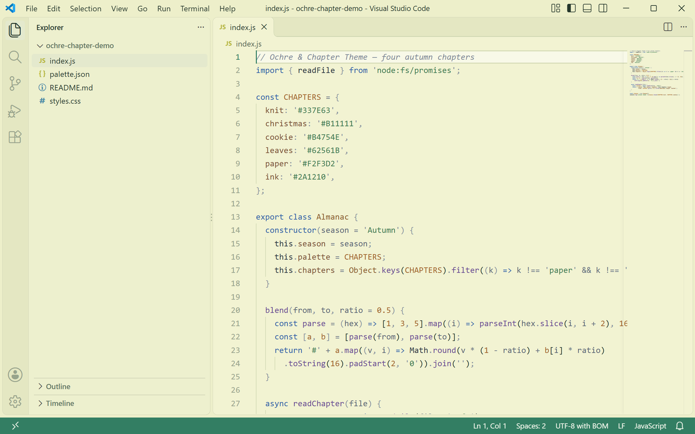
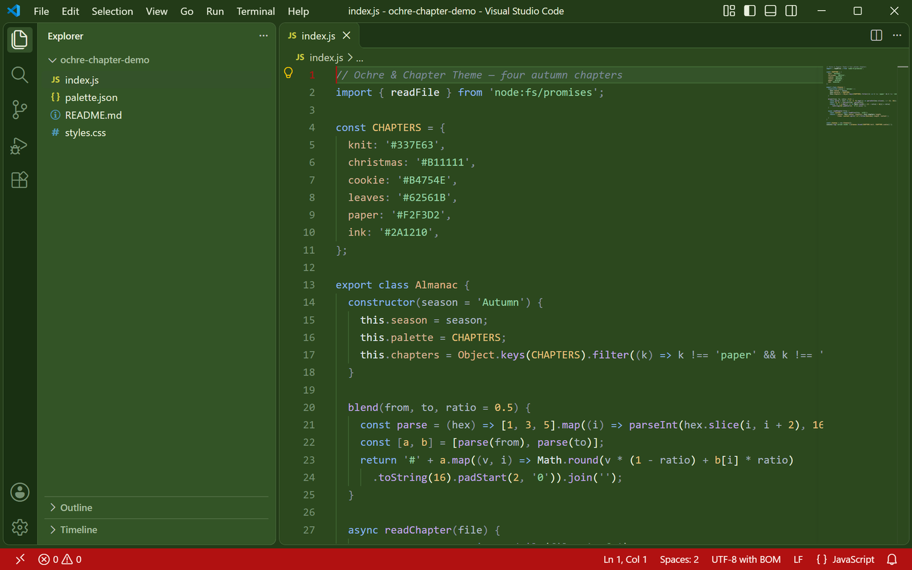
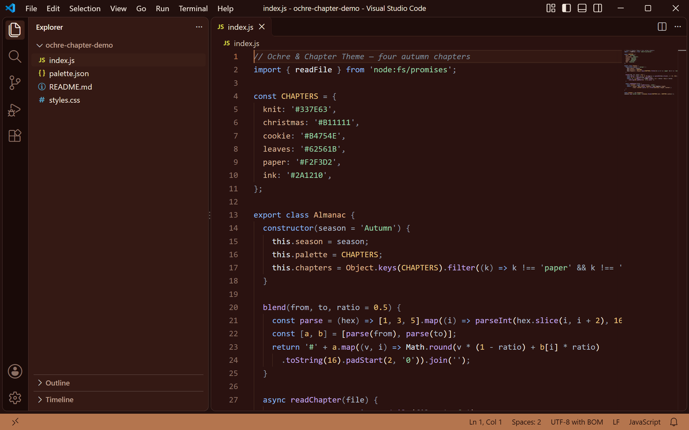
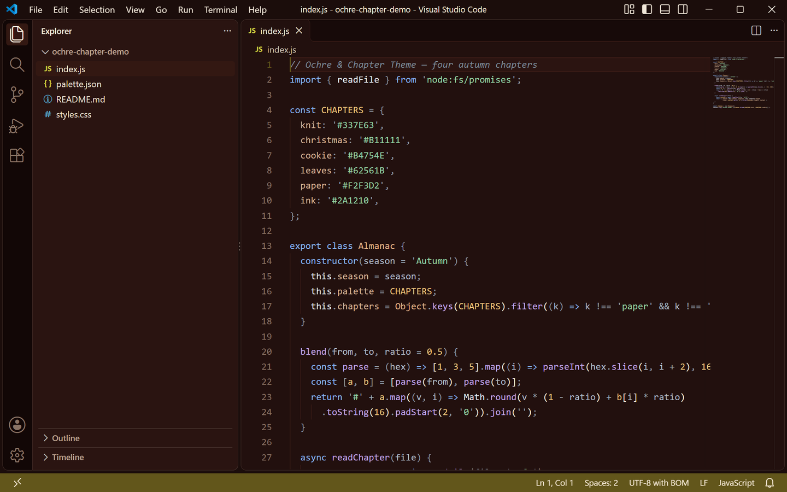

<div align="center">


# Ochre & Chapter Theme

**Four autumn chapters - knit, christmas, cookie and leaves - in one quiet book.**

[](https://github.com/vaxicy/ochre-chapter-theme)
[](https://code.visualstudio.com/)
[](#four-chapters)
[](LICENSE)
[](https://github.com/vaxicy/ochre-chapter-theme)

[English](#-english) - [简体中文](#-简体中文)

</div>

---

## English

**Ochre & Chapter Theme** turns four autumn palettes into four chapters of one book: a
pale knitted paper, a dark Christmas green, a cookie-brown night and a deep leaves chapter.
Each chapter keeps one accent in the status bar, active tab and focus ring.

<a id="four-chapters"></a>

### Four chapters

| Chapter | Editor | Accent | Feel |
|---|---|---|---|
| **Knit** | pale paper `#F2F3D2` | pine `#337E63` | light, soft, woolly |
| **Christmas** | forest `#2C481E` | red `#B11111` | dark, warm, festive |
| **Cookie** | cocoa `#2A1210` | terracotta `#B4754E` | dark, baking, cosy |
| **Leaves** | leaf litter `#22100E` | olive gold `#62561B` | dark, dry, autumnal |

### Screenshots

#### Knit


#### Christmas


#### Cookie


#### Leaves


### Install

1. Open **Extensions** (`Ctrl+Shift+X`), search **Ochre & Chapter Theme**, click **Install**.
2. `Ctrl+K Ctrl+T` -> pick **Ochre & Chapter Knit / Christmas / Cookie / Leaves**.

```bash
code --install-extension ochre-chapter-theme-1.0.0.vsix
```

### What's tuned

- **144 hand-placed UI colours** per chapter, one shared syntax palette and semantic tokens.
- **De-collided colours.** Autumn is a crowded family on the marketplace (pumpkin-hearth,
  harvest-tapestry, wheat-clay, burgundy-cream). Every surface and accent was measured
  against the library; each chapter's nearest neighbour is at least 0.04 away in HSL
  distance. The cream swatches from the source cards were all rejected as editors - they
  sat within 0.013-0.027 of existing themes.
- Four chapters, one book: the bookmark in the logo is the chapter you are reading.

The full colour table lives in [`COLOR-SPEC.md`](COLOR-SPEC.md).

---

## 简体中文

**Ochre & Chapter Theme** 把四套秋日配色做成一本书的四个章节：浅色的毛线纸、深色的圣诞绿、
曲奇棕夜，以及落叶深章。每个章节用一个强调色贯穿状态栏、活动标签与焦点框。

### 四个章节

| 章节 | 编辑区 | 强调色 | 感觉 |
|---|---|---|---|
| **Knit** | 毛线纸 `#F2F3D2` | 松绿 `#337E63` | 浅、柔软、毛织物 |
| **Christmas** | 深林绿 `#2C481E` | 红 `#B11111` | 深、温暖、节日 |
| **Cookie** | 可可棕 `#2A1210` | 陶土 `#B4754E` | 深、烘焙、安心 |
| **Leaves** | 落叶深棕 `#22100E` | 橄榄金 `#62561B` | 深、干燥、秋日 |

### 截图

#### Knit


#### Christmas


#### Cookie


#### Leaves


### 安装

1. 在 VS Code 中打开 **扩展**（`Ctrl+Shift+X`），搜索 **Ochre & Chapter Theme** 并点击 **安装**。
2. `Ctrl+K Ctrl+T` -> 选择 **Ochre & Chapter Knit / Christmas / Cookie / Leaves**。

```bash
code --install-extension ochre-chapter-theme-1.0.0.vsix
```

### 调校细节

- 每个章节 **144 个手工设定的 UI 颜色**，共用一套语法配色与语义 token。
- **颜色避撞**：秋季是市场上最挤的色系之一（pumpkin-hearth、harvest-tapestry、
  wheat-clay、burgundy-cream）。每处表面与强调色都做过实测，最近邻距离至少 0.04；
  原卡的奶油色与现有主题只差 0.013–0.027，全部弃用为底色。
- 四个章节一本书，logo 里的书签就是你正在读的那一章。

完整配色表见 [`COLOR-SPEC.md`](COLOR-SPEC.md)。

---

## License

Non-Commercial License - see [LICENSE](LICENSE).
